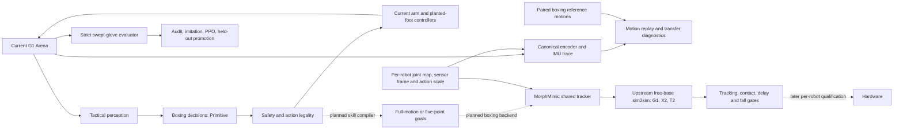

# ShadowBox architecture

## Goal and current boundary

ShadowBox is evolving toward one tactical boxing interface over robot-specific
whole-body execution. The running two-player baseline uses Unitree G1 models
with 29 native joints, IK placed feet, stabilized planar roots, disabled body
collisions and virtual glove touches. It tests decisions and motion targets;
free-base/contact tracking and eventual hardware qualification are separate
gates. This document is the versioned current-state reference. The local
`docs/planning.md` contains ignored execution notes and the active work schedule.

## Robotics patterns: what and why

| Pattern | What in ShadowBox | Why / adoption gate |
|---|---|---|
| Embodied agent | Separate observation, tactical action, motion controller, and safety supervisor. | Lets two players learn decisions while the same safety and physics checks apply to each policy. Keep this boundary. |
| Explicit physics | Model joints, mass, friction, foot/glove contact, balance, and scoring in MuJoCo. | Actions depend on these quantities. Next replace root support and virtual touches with tested contacts. |
| Imitation from video | Convert a short boxing clip to timestamped G1 root/joint targets with source and foot-contact labels. Replay and measure tracking and slide. | Gives natural stance, steps, and punches; accept clips only when retargeting and contact timing pass measured checks. |
| Simulation learning | Log aligned state, action, next-state transitions; fit residual or learned dynamics only where MuJoCo prediction is wrong. | Targets model error rather than replacing known rigid-body structure. Compare held-out prediction and rollout stability first. |
| World-action model | Predict opponent and robot state conditional on both actions. | Could support defense and planning; defer until logged contact-rich two-player trajectories exist. |
| RL and self-play | Train tactics against varied opponents; promote only on held-out seeds, activity, defense, and anti-repetition metrics. | Prevents the earlier cross-only scoring exploit. Do not optimize a policy against broken contact rules. |
| Sim-to-real | Calibrate actuators/contact, randomize uncertainty, test falls and safety on free-base G1. | Needed before hardware claims; stabilized-root wins do not transfer by themselves. |
| Differentiable model | Use gradients for parameter fitting or motion tracking when a specific experiment benefits. | Differentiability is optional for MuJoCo-based control and evaluation; benchmark prediction and cost before adding a backend. |

## External model roles

- [FLORA](https://research.nvidia.com/labs/gear/flora/) is a data-labeling engine for timestamped captions and process/outcome rewards. Use it only after ShadowBox has clips and episode video to label; keep rule-based touch and safety signals as ground truth.
- [SuperMimic](https://arxiv.org/abs/2610.28480) trains a motion tracker through a learned differentiable world model fitted to simulator transitions. ShadowBox's `supermimic` module currently loads hand-authored reference poses, **not** that trained method. The motion clip replay and optional transition export are the first compatible data interfaces; a real tracker needs free-base contact, a motion corpus, and an independently evaluated training backend.
- The new `shadowbox-motion-eval` command validates a G1 clip and reports joint tracking error, planted-foot slide, and height error. It can export `qpos`, `qvel`, `ctrl`, and next states under `tmp/` for later model fitting. The bundled jab clip is hand-authored, not extracted from video.
- [MorphMimic](https://lzyang2000.github.io/morphmimic/) is the selected candidate
  for sharing the low-level tracker across supported humanoids. Its pinned
  implementation and native/canonical bridge are integrated; actual tracking
  requires separately trained/exported weights and matching robot assets.
  Hardware demonstrations upstream cover G1; X2/T2 hardware remains pending.

Photorealistic rendering and generative visual refinement are outside this simulator's objective. Keep the main physics and evaluation loop runnable while adding these capabilities.

`v2/flora.py` contains placeholder annotation outputs, and
`policy/lfm3_policy.py` is an experimental optional policy/fallback scaffold.
Neither is a validated learned component of the current boxing loop.

## Tactical learning boundaries

| Module | Owns |
|---|---|
| `rl/actions.py`, `rl/observations.py`, `rl/reward.py` | Stable action schema, policy input, and reward arithmetic. No simulator training loop. |
| `rl/environment.py` | Applies one requested decision through `Match`, advances its motion, and returns an observation plus outcome. It never chooses the learner's action. |
| `rl/model.py`, `rl/policy.py` | Neural network and frozen actor adapter. No training or evaluation decisions. |
| `rl/ppo.py`, `rl/opponents.py` | Reactive imitation warm start, PPO updates, side swapping, start-distance curriculum, and varied/frozen opponents. |
| `rl/evaluate.py` | Held-out seeds, both sides, defense specialists, action variety, safety, and promotion. Training never promotes its own checkpoint. |

Tactical training and evaluation now both use strict swept 3D glove geometry.
The experimental confirmed PPO pilot uses reproducible categorical action
sampling; the activity, variety, touch-difference, safety and rejection gates
remain separate from training reward. It is saved under `tmp/policies/` and is
not automatically loaded by the live demo. Motion-tracking backends sit below
the tactical policy.

`rl/defense.py` adds a diagnostic gauntlet against legal, repeated head/body
attackers. It records incoming attempts, blocks during guard decisions,
conceded touches and opponent misses during evasions. This is separate from
promotion. The saved October 28 pilot passed its original passive-opponent
tests, but the new head-attack diagnostic conceded 23/74 attempts versus the
reactive baseline's 5/79. Body defense conceded 29/60 versus 40/66. Every case
had active threats, with no safety stops or rejected decisions. The saved
checkpoint predates current sources and is a diagnostic baseline, not a newly
promoted policy. Improving measured head defense is the immediate tactical
priority before another qualified training run.

`scripts/tactical_iteration.py` runs the stages in order. Its separate simulation, audit, training, and evaluation files are listed in `configs/README.md`. The audit writes per-decision action outcomes, root and joint targets, closest glove-to-head/torso center approach, and diverse qualified examples to `tmp/`; imitation weights action classes equally. Training refuses stale or failed audits; evaluation keeps its own seeds and promotion decision. Center distance is a diagnostic, while the referee's swept collision result remains the score.

For eventual G1 sim-to-real, first measure foot contact/slip, free-base balance, actuator tracking, impact and safety. Fit learned residual dynamics only if recorded hardware trajectories show repeatable MuJoCo prediction errors. A tactical win with a supported planar root does not establish hardware readiness.

## HoloMotion / HoloBoxing benchmark boundary

`integrations/holoboxing.py` launches the pinned upstream workflow through
separate training and retarget interpreters and delegates ONNX validation,
contact/impulse-scored matches and replay to upstream Docker. Settings live in
`configs/holoboxing.yaml`; output belongs under `tmp/holoboxing/`. See
[environment setup](../requirements/README.md#holoboxing--holomotion-benchmark).
No training dependencies are added to the core runtime.

The high-level ONNX contract is float32 `obs[1,1097]` →
`target_pose[1,225]`, containing five future poses for five body points. The
competition-specified frozen HoloMotion V2 whole-body tracker converts those
targets into joint actions. ShadowBox `Match` selects discrete `Primitive`
actions with stabilized roots and virtual touches, so these policies cannot be
substituted directly. Any future adapter needs explicit coordinate/history,
controller, free-base/contact and scoring validation.

Evaluate the exported policy in upstream matches first. Then compare behavior
with ShadowBox's strict swept-glove evaluator through separately recorded
scenarios and metrics, documenting different contacts, resets and scoring rules.
A shared score or a passing ONNX check alone cannot establish equivalence,
boxing skill, or hardware readiness. Keep existing tactical and simulation
modules as the local baseline.

## Multi-robot motion layer: implemented boundary and adoption plan

`external/MorphMimic` pins the official repository at
`aa40fe46a7fa995ba7a7354ad065a2c8ad64a302`. See
[integration and reproduction notes](morphmimic.md) for commands and contracts.

| Layer | Implemented now | Next gate |
| --- | --- | --- |
| Tactical decisions | Discrete `Primitive` actions, observed-state perception and independent strict evaluation | Preserve effective attack/defense when execution changes; qualify each robot separately |
| Robot profile | Official G1/X2/T2 canonical maps, signs, offsets, native defaults/scales and IMU identity | Add and test each new robot's semantics, limits, geometry and sensing frame |
| Measured data bridge | `Arena.full_velocity()`, `MorphMimicProfile.capture()`, optional canonical arrays in motion replay NPZ | Free-base/contact trajectories, matching control timing and complete upstream training-state format |
| Shared tracker workflow | Separate-environment conversion/train/export launcher and CPU sim2sim runner | Provide matching ONNX/robot bundles and references, then reproduce measured tracking |
| Boxing skill execution | Existing arm/foot controllers | Compile validated punches/guards/steps into full-motion or five-point goals; benchmark a tracker-backed boxer |
| Hardware | Later phase | Per-robot calibration, timing, actuator, fall, contact and operator-stop qualification |

The common layout has 29 canonical joints and 14 tracked bodies. The adapter
maps native joint angles with explicit sign/offset/permutation rules and holds
unmapped native joints at their defaults when decoding actions. Each trained
robot retains its own normalizers and retargeted references. The 125-value
descriptor encodes log action scales, gains, effort limits, geometry and mass;
the fitted scaling belongs with the training/export bundle. ShadowBox does not
substitute an invented descriptor from its modified supported-root model.

The IMU frame is part of the robot contract: G1/X2 use pelvis measurements while
T2 uses its trunk. Joint-name similarity alone cannot establish compatibility.
The current Arena measurement bridge supports G1; X2/T2 use the upstream
simulator path until equivalent boxing models/controllers are implemented.
New humanoids need mappings, physical descriptors, retargeted motion and
training/adaptation evidence. Robots outside this semantic layout require a
different representation; the current integration does not promise arbitrary
robot transfer.

Canonical traces contain raw 93-value proprioception frames and canonical
state/action arrays with source metadata. They preserve previous-action timing,
native elbow offsets and local gyro coordinates. They are diagnostic exports,
not MorphMimic's full world-model replay dataset, and their physics sampling
period is recorded separately from the trained 50 Hz control period.

The adoption order is: canonical contract checks → exported-policy parity and
per-robot free-base replay → delay/contact/fall benchmarks → boxing skill
compiler → two-player tactical comparison → later sim-to-real per robot.
HoloBoxing provides a complementary contact-scored boxing benchmark; its
1097-observation/225-target contract and MorphMimic's 450-value sparse goals
have different point order, time windows and output semantics. Any conversion
needs its own measured tests. The unified tracker does not replace the referee,
safety supervisor, tactical actor or its promotion gate.
