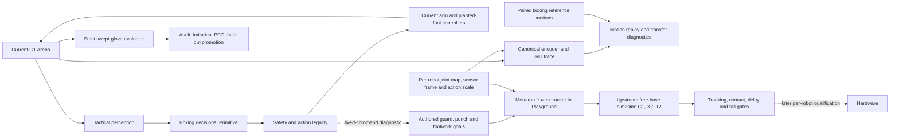

# ShadowBox architecture

## Goal and current boundary

**Infrastructure decision:** [MuJoCo Playground](playground.md) is the primary
scalable simulation/RL backend. Its pinned adapter supports batched smoke/train/
play and a two-free-base-G1 task. The transferred task uses a frozen Metatron
motion controller; the learned categorical actor currently selects guard or
body guard. Thirty-second posture/contact checks pass. Scripted exposed-target
controls now register head/body contacts at 0.55–0.60 m on both sides and two
attack delays; they do not qualify closed-guard attacks or a learned policy.
Head contacts from a standstill at 0.70 m remain timing-sensitive; a measured
0.5-second step-forward followed by a jab registers two to three head contacts
per side across sampled yaw/lateral and swapped-start controls. Authored turn
and footwork fixtures stay upright. Motion configs expose
the fixed-layout backward baseline (0.27 m/s for side A and 0.18 m/s for side
B); four paired reset seeds plus one swapped-start pair produce nearly equal
retreat. These side-specific commands remain diagnostics, with measurable
foot travel and residual facing drift. The established defensive actor selects
only IDs 0/8. A new `ShadowBoxG1SelfPlay` prototype exposes nine authored
primitive goals plus a CONTINUE action, which preserves the active skill phase;
launched jab/cross skills finish their authored motion, and a requested
follow-up punch is queued until that phase ends. It can train against a timed
script and frozen policy snapshots, but currently uses one tracked pair and
has no held-out promotion gate. Full boxing,
movement-policy quality, useful learned defense, scalable self-play and
real-time execution remain unqualified; detailed run evidence is in the local
ignored `docs/planning.md`.
The self-play runner iterates PPO candidates against the timed scripted attack
schedule and frozen previous policies.
Its player-centric observations remove global yaw from root orientations,
express opponent position and linear velocity in the controlled boxer's heading
frame, canonicalize quaternion signs at 180 degrees, and expose the controlled
boxer's active skill and phase. Training alternates the controlled side by
round. A round-end contact check evaluates each role against the scripted
opponent and advances the guard-width curriculum only when both roles record a
legal touch. Failed checks keep training at the same width; each finished round
atomically records league state for resumption. A held-out matrix runner checks
both sides, start orientations, seeds and opponent snapshots. The 24-case
head-defense candidate scored 81 head/18 body contacts against 10 head/44 body
from opponents. Raising body reward from 4 to 5 while keeping head-hit penalty
6 and block reward 0.5 yielded 63/23 against 1/48, with 313 blocks. This
improved results against the newest snapshot (12/1 vs 0/9), but its aggregate
net contact margin was 37 versus 45 for the prior candidate. Action 7 was
sampled 589 times but the cross goal never executed; traces show target-turn
and footwork requests canceling queued crosses. The current queue keeps a
follow-up through CONTINUE and target turns, while guard and footwork cancel it.
In a 12-case same-checkpoint ablation, cross goals executed for 224 steps
against frozen snapshots; outgoing body contacts rose from 11 to 20, total
candidate contacts stayed at 38, and conceded head contacts fell from one to
zero while conceded body contacts rose from 23 to 25. A six-round continuation
with this rule then completed all curriculum gates, but its 24-case held-out
matrix scored only 25 head/3 body against 2 head/30 body from opponents and
executed no crosses; it turned for all 2,400 steps against the older snapshot.
That candidate is not promoted. The next controlled run resumes from the
stronger head-defense checkpoint and its earlier opponent pool lineage to
separate queue semantics from the later pool's effect. Evaluation remains
diagnostic; there is no automatic promotion, skill extraction or robot
execution.
The controlled run `run-fac3c575226b` completed all six gates and all 24 held-out
cases. It scored 87 head/10 body against 30 opponent contacts, with no head
contacts conceded and 289 blocks; its aggregate net contact margin was 67,
versus 45 for `run-95b52f800f10`. It is the strongest measured checkpoint so
far, but it scored no body contacts against the scripted and newer-snapshot
styles, so it remains a diagnostic candidate. Replay inspection found that
the authored jab target could sit about 0.9 m from the shoulder while the
tracked wrist reached about 0.51 m. The current implementation now targets the
tracker's opponent-head point, limits the target to a configurable reach, and
uses configurable 0.27 m/s approach speeds. The fixed-command 0.9 m approach
moved each boxer about 0.27 m in one second. With a 1.5-second approach, the
open-target head-jab control recorded three head contacts per side without a
fall; a 0.11 m closed guard blocked both sides. The compiled tracker metadata
conditions torso, ankles and hands but has no elbow input. Kinematic inspection
measured about 0.39 m shoulder-to-wrist reach near full extension, below the
0.48 m authored jab limit. A second issue was the hidden glove proxy sitting
4 cm behind the tracker's wrist-to-palm point. The proxy now aligns at 0.12 m,
the configured jab reach is capped at 0.38 m, and the active jab blends a
calibrated four-joint arm target while preserving the tracked wrist path. In a
fixed-control test from 0.9 m with a 1.5-second approach and open target, both
sides made two head and two body contact episodes without falling; peak elbow
bend was about 14 degrees. This verifies the contact path for a scripted
positive control, not a learned jab or closed-guard strike. An elbow-aware
tracker trained on retargeted boxing examples remains the preferred motion
source. The first 0.9 m
self-play continuation produced no legal contacts in four completed rounds.
Adding the bounded approach reward alone did not pass the first 0.9 m gate.
The earlier qualified checkpoint trained at 0.6 m and failed its first 0.65 m
gate. The corrected curriculum passed 0.65 m and 0.70 m, but its candidate
recorded no contacts in a four-case 0.9 m held-out check under the updated jab
geometry. The next continuation resumed the qualified 0.70 m checkpoint. With
the updated gait and progress reward, it passed 0.75 m on candidate three and
0.80 m on candidate eight, then failed at 0.85 m; held-out evaluation of the
0.80 m checkpoint from 0.9 m scored no head/body contacts in the eight-case
held-out matrix against a 0.10 m guard; all 31 recorded candidate attacks were
blocked. Against an exposed 0.45 m guard, four held-out cases scored 21 head
and 43 body contacts, while conceding 8 body contacts. The jab runs and scores
against an exposed target; attacking through a tight guard remains
unqualified. A 10-second headless preview is saved as
`tmp/playground/gifs/run-4bbbee954f67-play.gif`. The current baseline uses
0.4 m/s approach speed, a 0.5 m target range, a 0.6-second queued approach,
and progress reward 12 per meter capped at that range. A fixed-control test at
0.4 m/s moved both sides about 0.64 m in 1.5 s, with no falls and 1–2 cm
settling drift. These simulator baselines still need closed-guard qualification
and later real-to-sim calibration.
The 0.6 m stage passed with one legal body contact per side and advanced to
0.65 m. The first three 0.65 m stages failed under the old action queue.
Evaluation showed every sampled approach occurred during a jab and was dropped.
The queue now preserves approach through the active punch and runs it for a
configurable 0.4 seconds. On the same failed checkpoint, that change executed
two approach bursts, moved 0.13 m forward, and produced one legal body contact.
The corrected curriculum run `run-longrange-curriculum3-fac3-20261111` passed
0.65 m on its fifth candidate (one head and one body contact per side), then
passed 0.70 m on its seventh candidate (one body contact per side). Its
continuation `run-longrange-approach04-20261112` uses faster approach and
stronger distance-progress reward. It passed 0.75 m on candidate three and
0.80 m on candidate eight, then failed its first 0.85 m gate. The latest
qualified checkpoint is round 008 at 0.80 m; held-out evaluation from 0.90 m
is pending. Neither candidate is promoted.
Fixed-contact controls exposed a reach problem with the default rib target: at a
0.11 m guard, lowering the configured body target to `-0.05 m` produced legal
body contacts on both sides while the robots stayed upright. This is a measured
simulator baseline, not a learned real-to-sim calibration; the PPO candidate
still needs held-out checks against frozen policies.
The cross goal has a bounded lateral trajectory arc so fixed controls can measure
whether angled body shots reach around a closed guard before changing PPO reward.
The CPU arena still owns the qualified tactical baseline. SOMA/Frax retargeting
and GAWM planning remain separate interfaces. ManiFlow is optional
serving/chunk benchmark inspiration, not a humanoid controller or dependency.

ShadowBox is evolving toward one tactical boxing interface over robot-specific
whole-body execution. The legacy CPU arena uses Unitree G1 models with 29 native
joints, IK-placed feet, stabilized planar roots, disabled body collisions and
virtual glove touches. The separate Playground task adds free-base motion and
physical contacts, but its boxing behavior and referee remain unqualified. This
document is the versioned current-state reference. The active work schedule and
dated evidence live in the local ignored `docs/planning.md`.

## Robotics patterns: what and why

| Pattern | What in ShadowBox | Why / adoption gate |
|---|---|---|
| Embodied agent | Separate observation, tactical action, motion controller, and safety supervisor. | Lets two players learn decisions while the same safety and physics checks apply to each policy. Keep this boundary. |
| Explicit physics | The legacy arena uses supported roots and virtual tags; the Playground task uses free-base G1s and physical floor/glove contacts. | Qualify contact outcomes, balance, foot support and referee semantics before replacing the legacy behavior. |
| Imitation from video | Convert a short boxing clip to timestamped G1 root/joint targets with source and foot-contact labels. Replay and measure tracking and slide. | Gives natural stance, steps, and punches; accept clips only when retargeting and contact timing pass measured checks. Use as planner initialization, not as force or scoring truth. |
| Simulation learning | Log aligned state, action, next-state transitions; fit residual or learned dynamics only where MuJoCo prediction is wrong. | Targets model error rather than replacing known rigid-body structure. Compare held-out prediction and rollout stability first. |
| World-action model | Predict opponent and robot state conditional on both actions. | Could support defense and planning; defer until logged contact-rich two-player trajectories exist. |
| RL and self-play | Train the high-level actor over authored boxing goals against a scripted warm-start opponent and frozen policy snapshots. | `ShadowBoxG1SelfPlay` implements a one-pair PPO loop over IDs 0–8, mixing a timed scripted opponent and frozen actors by episode. Held-out performance varies by opponent; body contacts and defense trade off across snapshots. Round-to-round pool rotation and queued punch execution are implemented; movement cancels pending punches after a same-checkpoint replay showed excess body contacts when movement did not. It is not batched or automatically promoted. |
| Sim-to-real | Calibrate actuators/contact, randomize uncertainty, test falls and safety on free-base G1. | Needed before hardware claims; stabilized-root wins do not transfer by themselves. |
| Differentiable model | Use gradients for parameter fitting or motion tracking when a specific experiment benefits. | Differentiability is optional for MuJoCo-based control and evaluation; benchmark prediction and cost before adding a backend. |

## External model roles

- [FLORA](https://research.nvidia.com/labs/gear/flora/) is a data-labeling engine for timestamped captions and process/outcome rewards. Use it only after ShadowBox has clips and episode video to label; keep rule-based touch and safety signals as ground truth.
- [SuperMimic](https://arxiv.org/abs/2610.28480) trains a motion tracker through a learned differentiable world model fitted to simulator transitions. ShadowBox's `supermimic` module currently loads hand-authored reference poses, **not** that trained method. The motion clip replay and optional transition export are the first compatible data interfaces; a real tracker needs free-base contact, a motion corpus, and an independently evaluated training backend.
- The new `shadowbox-motion-eval` command validates a G1 clip and reports joint tracking error, planted-foot slide, and height error. It can export `qpos`, `qvel`, `ctrl`, and next states under `tmp/` for later model fitting. The bundled jab clip is hand-authored, not extracted from video.
- [MorphMimic](https://lzyang2000.github.io/morphmimic/) is the selected candidate
  for sharing the low-level tracker across supported humanoids. Its pinned
  implementation and native/canonical bridge are integrated; actual tracking
  requires separately trained/exported weights and matching robot assets.
  Hardware demonstrations upstream cover G1; X2/T2 hardware remains pending.

Photorealistic rendering and generative visual refinement are outside this simulator's objective. Keep the main physics and evaluation loop runnable while adding these capabilities.

The browser viewer is opt-in and does not gate headless physics runs. When
requested, the Python launcher selects the NVIDIA GLX/EGL provider so Chrome
WebGL uses Thor hardware rather than Mesa llvmpipe. Headless rollout states use
MuJoCo's offscreen EGL path to produce a reduced-resolution GIF in the
configured `tmp/` directory (`playground.gif.directory`, default
`tmp/playground/gifs`). Set `playground.gif.enabled: false` to skip rendering.
Training stays headless; use a separate finite playback/evaluation run for a
visual artifact.

Unused FLORA placeholder outputs and the disconnected LFM3 fallback scaffold
have been removed. Future integrations need real callers and measured outputs.

Legacy code is retained only for a concrete value-add: the current arena supplies
working matches, scoring, safety and tactical evaluation until the Playground
two-robot task passes its replacement gates. Remove superseded implementations
and duplicate paths as those gates pass; preservation alone is not a reason to
keep them. The Playground migration is not yet complete.

## Tactical learning boundaries

| Module | Owns |
|---|---|
| `rl/actions.py`, `rl/observations.py`, `rl/reward.py` | Stable action schema, policy input, and reward arithmetic. No simulator training loop. |
| `rl/environment.py` | Applies one requested decision through `Match`, advances its motion, and returns an observation plus outcome. It never chooses the learner's action. |
| `rl/model.py`, `rl/policy.py` | Neural network and frozen actor adapter. No training or evaluation decisions. |
| `rl/ppo.py`, `rl/opponents.py` | Reactive imitation warm start, PPO updates, side swapping, start-distance curriculum, and varied/frozen opponents. |
| `rl/evaluate.py` | Held-out seeds, both sides, defense specialists, action variety, safety, and promotion. Training never promotes its own checkpoint. |

The legacy CPU tactical path uses strict swept 3D glove geometry and a separate
held-out evaluation. Its saved PPO pilot failed the head-defense comparison and
was not promoted. It remains a baseline, not evidence that the free-base G1
policy has learned boxing; current G1 results and gates are in the local
execution plan (`docs/planning.md`).

`scripts/tactical_iteration.py` runs the stages in order. Its separate simulation, audit, training, and evaluation files are listed in `configs/README.md`. The audit writes per-decision action outcomes, root and joint targets, closest glove-to-head/torso center approach, and diverse qualified examples to `tmp/`; imitation weights action classes equally. Training refuses stale or failed audits; evaluation keeps its own seeds and promotion decision. Center distance is a diagnostic, while the referee's swept collision result remains the score.

For eventual G1 sim-to-real, first measure foot contact/slip, free-base balance, actuator tracking, impact and safety. The Playground integration does not yet collect hardware trajectories or run system identification; the logged transition files are simulator data. Fit learned residual dynamics only if recorded hardware trajectories show repeatable MuJoCo prediction errors. A tactical win with a supported planar root does not establish hardware readiness.

## HoloMotion / HoloBoxing benchmark boundary

`integrations/holoboxing.py` launches the pinned upstream workflow through
separate training and retarget interpreters and delegates ONNX validation,
contact/impulse-scored matches and replay to upstream Docker. Settings live in
`configs/holoboxing.yaml`; output belongs under `tmp/holoboxing/`. See
[environment setup](../requirements/README.md#holoboxing--holomotion-benchmark).
No training dependencies are added to the core runtime.

The high-level ONNX contract is float32 `obs[1,1097]` →
`target_pose[1,225]`, containing five future poses for five body points. The
competition-specified frozen HoloMotion V2 whole-body tracker converts those
targets into joint actions. ShadowBox `Match` selects discrete `Primitive`
actions with stabilized roots and virtual touches, so these policies cannot be
substituted directly. Any future adapter needs explicit coordinate/history,
controller, free-base/contact and scoring validation.

Evaluate the exported policy in upstream matches first. Then compare behavior
with ShadowBox's strict swept-glove evaluator through separately recorded
scenarios and metrics, documenting different contacts, resets and scoring rules.
A shared score or a passing ONNX check alone cannot establish equivalence,
boxing skill, or hardware readiness. Keep existing tactical and simulation
modules as the local baseline.

## Multi-robot motion layer: implemented boundary and adoption plan

`external/MorphMimic` pins the official repository at
`aa40fe46a7fa995ba7a7354ad065a2c8ad64a302`. See
[integration and reproduction notes](morphmimic.md) for commands and contracts.

| Layer | Implemented now | Next gate |
| --- | --- | --- |
| Tactical decisions | Discrete `Primitive` actions, observed-state perception and independent strict evaluation | Preserve effective attack/defense when execution changes; qualify each robot separately |
| Robot profile | Official G1/X2/T2 canonical maps, signs, offsets, native defaults/scales and IMU identity | Add and test each new robot's semantics, limits, geometry and sensing frame |
| Measured data bridge | `Arena.full_velocity()`, `MorphMimicProfile.capture()`, optional canonical arrays in motion replay NPZ | Free-base/contact trajectories, matching control timing and complete upstream training-state format |
| Shared tracker workflow | Separate-environment conversion/train/export launcher and CPU sim2sim runner | Provide matching ONNX/robot bundles and references, then reproduce measured tracking |
| Boxing skill execution | Existing arm/foot controllers | Compile validated punches/guards/steps into full-motion or five-point goals; benchmark a tracker-backed boxer |
| Hardware | Later phase | Per-robot calibration, timing, actuator, fall, contact and operator-stop qualification |

The common layout has 29 canonical joints and 14 tracked bodies. The adapter
maps native joint angles with explicit sign/offset/permutation rules and holds
unmapped native joints at their defaults when decoding actions. Each trained
robot retains its own normalizers and retargeted references. The 125-value
descriptor encodes log action scales, gains, effort limits, geometry and mass;
the fitted scaling belongs with the training/export bundle. ShadowBox does not
substitute an invented descriptor from its modified supported-root model.

The IMU frame is part of the robot contract: G1/X2 use pelvis measurements while
T2 uses its trunk. Joint-name similarity alone cannot establish compatibility.
The current Arena measurement bridge supports G1; X2/T2 use the upstream
simulator path until equivalent boxing models/controllers are implemented.
New humanoids need mappings, physical descriptors, retargeted motion and
training/adaptation evidence. Robots outside this semantic layout require a
different representation; the current integration does not promise arbitrary
robot transfer.

Canonical traces contain raw 93-value proprioception frames and canonical
state/action arrays with source metadata. They preserve previous-action timing,
native elbow offsets and local gyro coordinates. They are diagnostic exports,
not MorphMimic's full world-model replay dataset, and their physics sampling
period is recorded separately from the trained 50 Hz control period.

The adoption order is: canonical contract checks → exported-policy parity and
per-robot free-base replay → delay/contact/fall benchmarks → boxing skill
compiler → two-player tactical comparison → later sim-to-real per robot.
HoloBoxing provides a complementary contact-scored boxing benchmark; its
1097-observation/225-target contract and MorphMimic's 450-value sparse goals
have different point order, time windows and output semantics. Any conversion
needs its own measured tests. The unified tracker does not replace the referee,
safety supervisor, tactical actor or its promotion gate.

## Configurable Isaac Lab environment

The separate `configs/isaaclab.yaml` selects Isaac Lab 3.0.0 through
`integrations/isaaclab.py`; MuJoCo remains the default boxing backend. The
launcher invokes the upstream G1 velocity task with zero actions, Newton /
MuJoCo-Warp, bounded steps, and logs under `tmp/isaaclab/`. It is a standalone
free-base gravity/contact smoke test, not a two-player ShadowBox match. Its
separate environment and execution prerequisites are in [Isaac Lab setup](isaaclab.md).
The integration is not yet validated with an actual Isaac Lab simulation.

A boxing backend still needs two robot instances, consistent action and observation
contracts, measured glove and foot contacts, referee and safety semantics, and
seeded cross-simulator comparisons. Preserve the existing gait and require
per-robot free-base tracking, contact, timing and fall evaluation before
hardware use. NVIDIA GR00T/GEAR-SONIC may supply a learned whole-body control
research path, but is not a drop-in boxing policy; assess it after its model,
robot mapping, weights and supported hardware can be tested. FLORA is an
offline video annotation candidate, not a replacement for contact scoring.

## Current Playground boundary

The tracker-backed task runs two free-base G1s through pinned Playground/reaf
and uses the qualified frozen Metatron controller for low-level execution.
Closed fists are fixed at reset; the current categorical actor has only guard
and body-guard choices. Scripted exposed-target contact controls pass across
both sides and 0.55–0.60 m; head punches at 0.70 m miss at immediate onset.
The task has no qualified walking policy, learned two-sided boxing, round
referee, vision frontend or real-time performance. Do not infer those
capabilities from a finite PPO transport pilot.

The architecture and task boundaries live here; operator setup is in
[playground.md](playground.md), pinned motion-artifact commands are in
[metatron-playground.md](metatron-playground.md), and detailed implementation
evidence plus next acceptance gates are in the local execution plan
(`docs/planning.md`). Keep the CPU arena until its live callers and capabilities
pass the removal gates in
[legacy-retention.md](legacy-retention.md).
